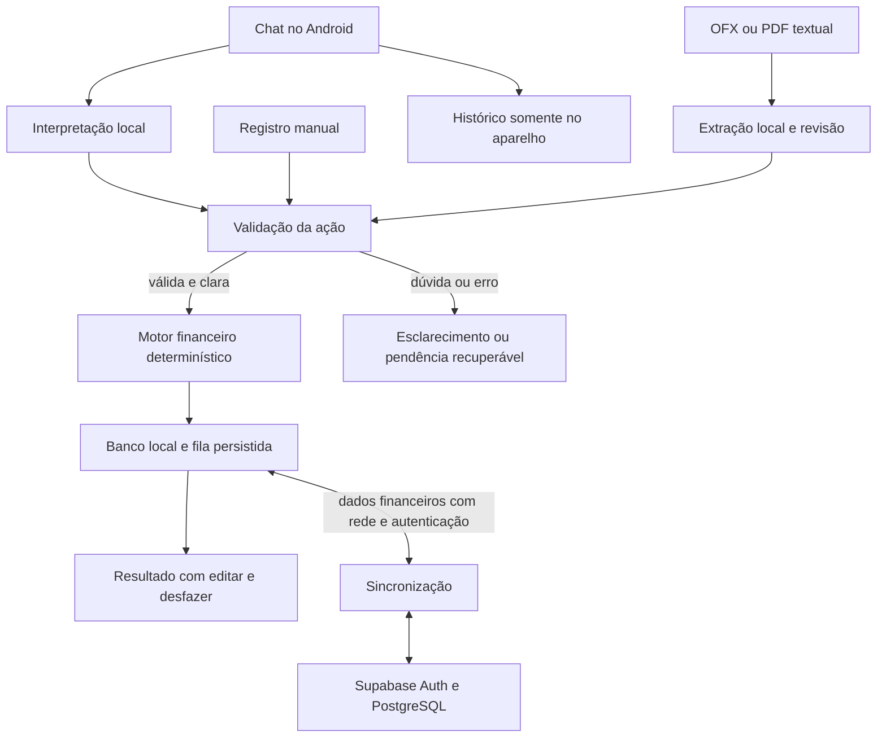

# Arquitetura do Accord

Revisão: 24/10/2026. O repositório contém aplicativo Android/Compose, motor Kotlin, persistência
Room, protocolo/fake/adaptador remoto, migrações Supabase e testes. S1 está fechado em
`accord-9tl`, com pendências em `accord-abv`; S2 está entregue em `accord-rsw` (testes JVM,
Supabase local e emulador), com validação nos aparelhos em `accord-chf` e decisões abertas em
`accord-smv`. A existência desses arquivos não comprova implantação hospedada, validação nos dois
celulares; os ADRs 0022–0025 e 0027–0029 foram aceitos em 24/10/2026, mas isso não prova implantação nem medição.

## Fontes e autoridade

- [AGENTS.md](AGENTS.md): regras de trabalho dos assistentes.
- [Plano de desenvolvimento](docs/plano-desenvolvimento.md): requisitos, etapas e aceite.
  Decisões posteriores das seções 14 e 16 prevalecem sobre propostas anteriores.
- [Índice das telas](docs/specs/design/README.md): navegação, prioridades e regras comuns de UX.
- [Especificações 01–38](docs/specs/design/README.md#4-índice-dos-arquivos): estados, recuperação,
  acessibilidade, aceite e dependências de cada tela. IDs identificam telas, não versões de API.
- [ADRs](docs/adr/README.md): decisões, motivos e histórico; status de decisão é separado da
  situação de implementação. ADRs propostos não alteram requisitos aprovados.

A documentação de produto é a referência; esta arquitetura a resume. Propostas de implementação
não transformam escolhas abertas em requisitos aprovados. Divergências sem solução nessas fontes
exigem registrar a questão no Beads e esclarecer a decisão afetada.

## Decisões confirmadas e escolhas abertas

| Tema | Confirmado | Ainda depende de implementação ou validação |
| --- | --- | --- |
| Aplicativo | Android nativo, Kotlin e Jetpack Compose | Módulos/build existem; desenho concreto da fachada proposto no ADR 0022 e validação nos aparelhos pendente |
| Aparelhos | Galaxy S20 FE como referência mínima e Galaxy S23 FE; S20 FE com 6 GB de RAM total informados | Variantes, Android, espaço livre, RAM do S23 FE e consumo real |
| Inferência | P0: interpretador local por regras ([ADR 0036](docs/adr/0036-interpretador-por-regras-no-p0-e-slm-opcional.md)); SLM no aparelho é candidato opcional adiado, sem fallback automático para IA remota | Promoção das regras ao produto; se o SLM voltar: modelo, motor, quantização, qualidade em português e medição nos aparelhos |
| Distribuição | Download separado no primeiro uso, até 2 GB decimais por celular | Hospedagem, tamanho efetivo, retomada e espaço instalado |
| Desempenho | Meta desejada de até 5 s do envio ao resultado visível de frase curta, com modelo carregado; sem corte eliminatório (31/10/2026) | Medições nos dois celulares; carga inicial, RAM, bateria e aquecimento |
| Compartilhamento | Supabase hospedado no plano Free, Auth e PostgreSQL | Esquema, RPC, RLS e protocolo locais existem; decisões aceitas nos ADRs 0023/0024; hospedagem e validações finais não comprovadas aqui |
| Dados locais | Banco/fila persistidos; Room com BundledSQLiteDriver; Chat local | Room implementado (ADR 0016); política detalhada de acesso local e Chat de S3 pendentes |
| Importação | OFX estruturado e PDF bancário com texto selecionável, processados localmente. Leitor OFX próprio em `:core` (`core.importing.OfxReader`, S4.1) e leitor do CSV do Accord, formato nosso e não de banco (`core.importing.CsvReader`, [ADR 0042](docs/adr/0042-csv-no-formato-proprio-do-accord.md), proposto), verificado com testes sintéticos e com quatro exemplos do usuário (Bradesco, Itaú conta, Nubank cartão e conta). Reconciliação e regras de cobrança em `:core` (S4.2/S4.2b). Sessão de importação na fachada (`ImportSession`, Room esquema 6, comando `ConfirmImportBatch` e agregado sincronizado `ImportBatch`, S4.3; [ADR 0040](docs/adr/0040-lote-de-importacao-confirmado-e-confirmacao-atomica.md), proposto), testada em JVM e no pgTAP local. Seleção de arquivo pelo Android (somente leitura, formato pelo conteúdo) e telas 15, 16 e 17 com a parte da 14 em Revisar (S4.4). Fila única de pendências (tela 18) e resolução das dúvidas de importação (tela 19, comando `ResolveImportItem`, S4.5), testadas no emulador. Leitor de PDF por layout (S4.6, [ADR 0041](docs/adr/0041-leitura-de-pdf-por-layout-sobre-pdfbox-android.md), aceito): só a fatura do cartão Itaú, validada com **um** exemplo real do usuário | Extrato Itaú em PDF e outros layouts, tela 19 para fatura/parcelas/estorno, aceite do ADR 0040, validação nos dois celulares e compatibilidade com fatura/extrato Itaú em BRL (sem amostra real) |
| Interface | Lucide e catálogo/logotipos locais de logos-bancos-br, versão estável fixada; [tokens](docs/design-tokens.md) e [ícones](docs/icones-categorias.md) decididos | Ativos incorporados; revisão visual nos temas e aparelhos pendente |

Qwen3-0.6B quantizado, llama.cpp/GGUF e LiteRT-LM são candidatos do plano §13.3, sem aprovação
por benchmark. Formato de um candidato não implica compatibilidade com outro motor. Download
máximo: 2.000.000.000 bytes para o conjunto necessário; não define RAM ou espaço instalado.
A meta de 5 s exclui download, carga inicial e sincronização e não impõe cancelamento automático.
Conforme o [ADR 0035](docs/adr/0035-meta-de-latencia-desejada-sem-corte-eliminatorio.md), excedê-la
isoladamente não reprova candidato nem bloqueia integração; os critérios de segurança/qualidade permanecem.

## Mapa atual do repositório

Gráficos das telas 05, 33 e 20/21: Charty 3.2.0 atrás de `ui/components/MoneyChart`, com
valores exatos/lista acessível, desenho local e sem animação de crescimento
([ADR 0055](docs/adr/0055-biblioteca-de-graficos-charty.md)). O wrapper consome as projeções
existentes; não calcula regras financeiras. Validação nos Galaxy/TalkBack em `accord-g3xc`.

```text
accord/
  AGENTS.md, CLAUDE.md       regras compartilhadas; CLAUDE.md importa AGENTS.md
  ARCHITECTURE.md            mapa atual, decisões e responsabilidades planejadas
  core/                      módulo Kotlin JVM sem Android: motor financeiro, contrato da fachada (S1);
                             core.chat (proposta, validador, coordenador, bateria fictícia) e
                             core.model (manifesto, instalação verificada, execução) do S3
  persistence/               Room: fachada local, operações, sessão e motor de sincronização; histórico
                             do Chat (tabelas chat_*, só no aparelho)
  remote/                    fake e adaptador Supabase HTTP (JVM)
  supabase/                  configuração local, migrações e testes pgTAP; sem prova de implantação hospedada
  app/                       Android: tema com os tokens, navegação das 5 raízes, telas Compose (S1.8);
                             telas implementadas: Orçamento, categoria, Lançamentos, detalhe, registro e
                             edição, ações vinculadas (pagar, receber, estorno, cancelar parcelas),
                             Compromissos, Cartão e faturas, Rendas, Mais, Contas, Categorias, Limites.
                             S2: Acesso, Espaço, Primeiros passos, Sincronização e Escolher versão (conflito),
                             indicadores e envio em segundo plano (WorkManager).
                             S3: Chat (04) com recibo, perguntas, falhas e registro manual com o que foi
                             entendido; Modelo no aparelho (25); histórico do Chat em Mais (limpar, exportar,
                             importar). Sem motor integrado o Chat guarda a mensagem ("sem modelo").
                             Revisar só lista os conflitos de edição.
                             Assets locais: catálogo de bancos e logos (assets/banks, logos-bancos-br) e marcas (assets/vendors, Simple Icons)
  poc/                       bancada de medição da Etapa 0 (S3 §2): app debug separado app.accord.poc, sem
                             INTERNET, com o llama.cpp fixado em poc/llama-cpp.pin e uma ponte JNI mínima;
                             roda o prompt, o contrato e o validador do produto. Não é produto nem escolhe
                             motor. Entrada separada de classificação sem SLM medida no S20 FE em 26/10,
                             aceita pelo usuário como validação suficiente também para o S23 FE;
                             não comprova desempenho conjunto do Chat (docs/poc/auditoria-categorias-e-s20fe.md)
  pocpc/                     bancada JVM de qualidade e classificação de categoria, fora do produto
  categorybench/             núcleo experimental de categoria compartilhado por :pocpc/:poc;
                             :app depende dele apenas em debug para o piloto opt-in com fake,
                             sugestões e confirmação (ADR 0032); sem pesos/adaptador no release
  scripts/poc/               scripts da bancada (preparar, enviar modelos, rodar, coletar) e report.py
  gradle/libs.versions.toml  versões fixadas; wrapper Gradle 9.8.2 (gradlew)
  docs/
    plano-desenvolvimento.md requisitos, decisões e critérios de aceite
    specs/                  specs de desenvolvimento S1–S7
      design/               índice e telas 01–38
    adr/                    decisões, propostas, guia e template
  .beads/                   tarefas e conhecimento persistente via bd
  .claude/                  agentes, skills e hooks
  .agents/                  entradas de descoberta de skills para Codex
  .codex/                   adaptadores de agentes, configuração e hooks
```

Existem `:core`, `:persistence`, `:remote`, `:app`, `:poc`, `:pocpc` e `:categorybench`
(comandos da classificação em docs/poc/auditoria-categorias-e-s20fe.md). Detalhes implementados
da fachada, RPC e protocolo estão nos ADRs 0022–0024, aceitos em 24/10/2026. Projeções financeiras
assumidas em S1 estão no ADR 0025. O contrato do Chat e o histórico local (0027), a distribuição e o
ciclo de vida do modelo (0028) e a troca de forma de pagamento (0029) foram aceitos pelo usuário em 24/10/2026
e estão implementados no S3 (aceite registrado em `accord-awb`; implantação e medições nos aparelhos seguem pendentes).
Esta revisão documenta o estado; não aprova as demais propostas nem escolhe framework de DI, modelo/motor,
hospedagem dos pesos ou leitor bancário. A medição isolada de categorias no S20 FE não aprova o motor
nem o desempenho do Chat nos dois aparelhos. O adaptador de motor do produto e a fonte hospedada
de pesos/download em segundo plano continuam pendentes.

O [desenho de frases livres de 26/10](docs/poc/pipeline-frases-livres.md) propõe reduzir o SLM
a intenção/ligação de trechos, reutilizar o validador/fachada e manter classificação assistida
na porta separada já usada pelo piloto. [ADR 0033](docs/adr/0033-pipeline-reduzido-de-frases-livres.md)
está proposto; o fake permanece disponível e o adaptador real não foi integrado nesta entrega.
Triagem começa no S20 FE, sem estender ao novo fluxo a dispensa do S23 FE para o classificador.

A [triagem reduzida de 26/10](docs/poc/triagem-frases-livres-s20fe-2026-10-26.md) foi executada
no S20 FE, somente na bancada: seis candidatos na amostra inicial e dois nos 60 casos completos.
O perfil atual não foi recomendado para integração por erros aceitos e falhas de resposta a
perguntas. `accord-nsu.15` mantém a próxima iteração; o piloto do Chat continua com fake.

A [qualificação de frases novas](docs/poc/qualificacao-frases-novas-2026-10-26.md), `accord-nsu.16`,
congela 120 casos e compara os seis candidatos em duas variantes e dois controles sem SLM,
incluindo descrição e decomposição dos campos. O avanço autorizado depende de segurança e
ganho sobre o melhor controle, seguido da triagem física. O S20 FE não está disponível nesta
sessão; a rodada interrompida ainda precisa ser recuperada. Feedback com retenção local de
30 dias e sete dias de uso natural continuam condicionados à integração real, ainda ausente.
Na matriz PC completa, nenhum perfil qualificou: o melhor modelo teve 69/120 casos completos
contra 67/120 do controle mais forte, mas quatro propostas divergentes aceitas. Correções
de fronteira/pessoa e ação/resposta/descrição estão em `accord-nsu.17`/`.18`, antes de nova escolha.

As [correções v4/v5](docs/poc/correcoes-preparacao-v4-2026-10-26.md) dessas tarefas foram
verificadas sem modelos, preservando corpus/snapshots e replay do validador v4. A próxima
qualificação (`accord-nsu.21`) usa Qwen3.5-2B Q5_K_M como referência e mantém os oito candidatos;
segurança e ganho completo sobre controle forte continuam bloqueando a integração `accord-q12`.

A [qualificação v2](docs/poc/qualificacao-v2-resultados-2026-10-26.md) já executou 120 frases
novas: Qwen Q5 em chamada única 96/120 completos contra controle forte 98/120, ambos com dois
efeitos errados. Nenhum perfil qualifica. `.21` permanece aberto, dependente de `.22`/`.23`;
sem integração ou medição física nesta rodada, mantendo os oito candidatos registrados.

As [correções de escopo e a qualificação v3](docs/poc/escopo-v5-e-qualificacao-v3-2026-10-27.md)
separam pergunta/recibo/mensagem nova na bancada e no validador. A medição primária usou
v5/validador6: controle forte 93/96 completos, Qwen Q5 shared30/single24,
zero efeito indevido em todos. Nenhum ganho do modelo; `.24` passa a bloquear a qualificação
`.21` e a integração. Não altera contrato, persistência ou escolha de modelo/motor; fake mantido.

A [continuação v6/validador8](docs/poc/descricao-v6-e-origem-v8-2026-10-27.md) mantém respostas,
correções e decisões ancoradas no caminho local e limita o SLM experimental à seleção literal
de descrição. Corrige a falsa instituição em “banco de jardim”, preservando a barreira para
origem desconhecida. Essa entrega foi verificada deterministicamente, antes da inferência v6.

A [qualificação v4](docs/poc/qualificacao-v4-resultados-2026-10-27.md) posterior congelou 64
frases novas e comparou um controle forte ao Qwen Q5: 58/64 completos contra 52/64, zero ganhos
e seis perdas de descrição; zero erro financeiro/efeito indevido. As 128 notas e 200 hashes
foram conferidos. Não qualifica para triagem física ou integração. `.24`/`.21` seguem abertas,
com revisão de candidatos/proteção da descrição em `.27` e resposta de data em `.26`.

As [correções v7/validador9](docs/poc/correcoes-descricao-v7-data-v9-2026-10-27.md) dessas
duas tarefas reconhecem a resposta de data e restringem descrições a frases completas,
com validação independente de trechos periféricos/truncados. São 400 casos de regressão,
sem inferência nova; 397 completos, zero efeito indevido. Não demonstram contribuição do
SLM nem qualificam a integração: `.24`/`.21` permanecem abertas; fake e oito candidatos mantidos.

A [qualificação v5](docs/poc/qualificacao-v5-resultados-2026-10-27.md) posterior ao ajuste
congelou 64 frases novas: Qwen Q5 59/64 completos, controle58/64, um ganho de descrição e
nenhuma perda, zero erro financeiro/efeito indevido. É elegível apenas à triagem física;
persistem cinco descrições erradas aceitas e limites de autoria/amostra. `.24` conclui a
etapa PC, `.21` depende da [triagem `.28`](docs/poc/triagem-v7-aparelhos-2026-10-27.md).
Bancada Android preparada e controle sem SLM exercitado só no emulador, sem Galaxy medido,
integração ou escolha definitiva de modelo/motor.

O usuário limitou depois a [validação `.28` ao emulador](docs/poc/validacao-v7-emulador-2026-10-27.md).
Qwen v7/validador9 empatou com o controle58/64; o ganho PC não se repetiu no Android/CPU.
Três repetições estáveis, zero erro financeiro aceito/efeito indevido; chamadas curtas após
a primeira com mediana7,65s, cancelamento e retomada exercitados. `.28` conclui esse escopo,
`.21` continua aberta com revisão de utilidade/custo em `.29`; sem integração ou medição Galaxy.

## Responsabilidades e fluxo local

O fluxo abaixo é conceitual e inclui S3/S4 ainda planejados. As responsabilidades do plano
§13.1 não obrigam um módulo Gradle por linha. Manter regras
financeiras testáveis sem inferência, rede ou componentes de interface.

| Responsabilidade | Papel |
| --- | --- |
| Interface Compose | Receber texto e ações, apresentar recibos, dúvidas, totais e estados reais |
| Interpretador local | Propor intenção e campos estruturados com contexto curto e relevante |
| Validador de ações | Verificar formato, valores, referências, alvo de correção e ambiguidade |
| Motor financeiro | Calcular dinheiro, parcelas, faturas, limites e previsões por regras explícitas |
| Persistência local | Preservar registros, rascunhos, pendências, configurações e operações por enviar |
| Sincronização | Enviar/receber dados autorizados com identidade, idempotência e controle de versão |
| Importação local | Extrair OFX/PDF, preparar prévia e preservar decisões de conferência |



O SLM propõe; o aplicativo valida e executa. Saída bem formada não prova interpretação correta.
Consultas usam funções controladas, sem SQL livre do modelo. O motor usa centavos ou decimal
exato; totais não são calculados pelo SLM a partir do prompt. Ações claras válidas salvam sem
confirmação extra, com editar/desfazer; dúvidas preservam o trabalho e pedem esclarecimento.
Dúvida apenas sobre fatura perto do fechamento permite registro provisório “a conferir”.

Inferência e extração não bloqueiam a interface. Falha, demora, cancelamento ou modelo ausente
preservam mensagem e alternativa manual. Download mostra tamanho real e progresso; instalação
incompleta não é apresentada como modelo pronto. Atualizar modelo não reinterpreta dados salvos.

## Modelo financeiro e invariantes

Vocabulário do plano §§3–5 e do índice das telas; não é descrição exaustiva do esquema implementado.

| Conceito | Regra que precisa permanecer verdadeira |
| --- | --- |
| Espaço do casal | Duas contas individuais, mesmo acesso de criação/edição e orçamento compartilhado |
| Conta bancária | Banco e apelido compartilhados; conta padrão é preferência individual de preenchimento |
| Lançamento | Identidade estável, autor e, quando conhecido, quem gastou; correção não cria cópia |
| Compra parcelada | Compra e parcelas vinculadas; cada parcela ocupa sua fatura sem somar o total novamente |
| Recorrência | Série sem término obrigatório, distinta de parcelamento finito |
| Fatura/pagamento | Cartão usa mês de vencimento da fatura atribuída; quitação não gera nova despesa |
| Limite | Categoria principal com divisão opcional entre subcategorias, parte do mesmo total |
| Pendência | Dúvida ou conflito recuperável; rascunho inválido não é despesa efetivada |
| Intenção P2 | Compartilhada, separada de compromisso; conversão explícita gera um único vínculo |

- **Datas:** Pix usa a movimentação. Boleto não pago é previsto no vencimento; pago ocupa só
  o mês do pagamento efetivo, retirando a previsão anterior e preservando as duas datas.
  Cartão usa fatura atribuída; fechamento dia 8 e vencimento dia 15 são configuração inicial,
  sem garantir atribuição do emissor. Atividade P1 usa data original, sem outra despesa.
  Vários cartões, cada um com fechamento, vencimento e limite próprios, cartão padrão individual e conta vinculada ([ADR 0052](docs/adr/0052-multiplos-cartoes-cartao-padrao-e-conta-vinculada.md), aceito em 08/11/2026; implementação local em `accord-k9zy`, Room 19 e protocolo 2; migração hospedada e validação física pendentes).
- **Limites:** soma destinada às subcategorias não supera o principal. Sem distribuir difere de
  restante após gastos; subcategoria sem divisão não recebe limite zero presumido. Excesso não
  amplia nem redistribui limites. Cada edição escolhe só o mês ou esse mês e os seguintes,
  preservando anteriores, categorias não editadas e configuração futura numa edição pontual.
  Reorganizar subcategoria com divisão exige revisar a distribuição envolvida antes de confirmar,
  sem transferência silenciosa. Limite não definido difere de zero; omitir percentual sem sentido.
- **Correções:** categoria/descrição de compra parcelada mudam em todas as suas parcelas,
  inclusive anteriores. Recorrência escolhe só a ocorrência ou esta e as próximas. Não aplicar
  esses alcances por suposição a valores, datas, cancelamentos ou pagamentos. Preservar
  pagamentos, identidades e originais importados; recalcular períodos afetados.
- **Créditos:** estorno confirmado reduz categoria original no período do crédito, preserva
  compra e não vira renda. Futuras canceladas só saem após confirmar não cobrança, sem crédito
  fictício. No P0, quitação da fatura é integral e conferida; parcial/divergente mantém valor
  real para revisão. Encargos confirmados ficam em Serviços > Tarifas e juros, corrigíveis,
  sem projeção bancária inventada.
- **Totais:** renda prevista não é saldo confirmado; pago não se soma ao comprometido; conhecidos
  e novos variáveis estimados são separados. Assinaturas ficam em Assinaturas; compras variadas
  usam categoria predominante. Simulações/intenções não alteram orçamento real.

## Autenticação, autorização e sincronização

Fontes: telas [01](docs/specs/design/01-acesso.md), [02](docs/specs/design/02-espaco-do-casal.md) e
[26](docs/specs/design/26-sincronizacao.md). Supabase Auth usa e-mail/senha. Piloto sem envio de
confirmação, recuperação, OTP, magic link ou convite por e-mail. Planejar Confirm Email
desativado, sem SMTP. E-mail identifica login sem comprovar posse; ajuda orienta atendimento
manual fora do app, em ambiente confiável.

A segunda conta entra por código de convite gerado no aplicativo. Autorização do espaço e
validação/consumo do convite ocorrem no serviço/banco; alterar referência no cliente não concede
acesso. Ambos têm os mesmos direitos no espaço, sem hierarquia administrativa no produto.
Credenciais administrativas nunca entram no aplicativo. Há testes de permissão locais para
associados e não associados; execução histórica está no Beads, sem reexecução nesta revisão.
Isso não comprova permissões de um projeto hospedado.

Banco e fila preservam trabalho offline conforme autorização local, cuja política detalhada
continua aberta. Sincronização exige sessão válida, identidade estável por operação,
idempotência e controle de versões no serviço. Resposta perdida seguida de reenvio não reaplica
operação reconhecida. O desenho técnico deve garantir consistência entre alteração local e fila.

Conflitos preservam as duas versões para escolha explícita, sem última edição vence ou mesclagem
automática. A escolha mantém identidade; nova alteração concorrente exige comparação atualizada.
Versões não viram duas despesas. Realtime, se adotado, não substitui fila/persistência/protocolo.
Mensagens e PDFs/OFX completos não são sincronizados; intenções salvas entram apenas em P2.

Mostrar salvo no aparelho, aguardando envio, reconhecido e conflito separadamente. Último sucesso
não prova ausência de registros offline no outro celular. Sessão expirada, serviço pausado ou
quota não descartam operações. Se o Free exigir pagamento, rever com o usuário sem habilitar
cobrança automática nem prometer gratuidade permanente. Condições comerciais devem ser
reverificadas quando uma decisão depender delas; este texto registra a escolha de produto.

## Importação e rastreabilidade

Fluxo: [selecionar](docs/specs/design/15-importar-arquivo.md) →
[revisar](docs/specs/design/16-revisar-importacao.md) → [resultado](docs/specs/design/17-resultado-importacao.md).
OFX usa parser estruturado local; PDF usa extração local de texto dos movimentos. SLM pode ajudar
classificação sem substituir extração/conferência. OCR e PDF digitalizado/imagem ficam fora do P0.

Sem cópia permanente do PDF/OFX: persistir extraídos, campos originais dos movimentos, metadados
e decisões; descartar temporários ao concluir/cancelar leitura sem alterar o arquivo externo.
Retomar revisão usa dados persistidos; reler exige nova seleção. Reimportar não duplica;
coincidência de valor/data não funde compras legítimas. FITID repetido divergente exige revisão.

Itaú é prioridade de validação de fatura e extrato em BRL, sem suporte comprovado e sem promessa
de ambos os formatos para ambos os tipos. A inspeção documentada de `example.ofx` tem dez
movimentos em EUR e FITID repetido; não comprova origem Itaú ou compatibilidade BRL. Moeda não
suportada bloqueia efetivação, preservando moeda da prévia sem conversão automática. A amostra
não está no repositório. Débito de quitação do extrato vincula à fatura sem duplicar despesas.

## Previsões, alertas e evolução

Previsões explicam conhecidos e novos variáveis sem projetar novamente parcelas/contas já
incluídas; dados incompletos reduzem confiança. No máximo um evento de alerta por categoria
principal por semana, destinado a todos os membros do espaço, respeitando preferências/permissões dos aparelhos.
Janela em America/Sao_Paulo: segunda 00h até segunda seguinte 00h, fim exclusivo. Renovar não
agenda envio; editar limite/recalcular não renova cota. Notificar offline primeiro foi confirmado;
coordenação concreta entre aparelhos continua pendente de implementação em S5 (ADR 0020).

São 28 telas P0, cinco P1 e cinco P2. P0 entrega registrar, acompanhar, importar, conferir e
retomar. P1 acrescenta revisão semanal, atividade, assinaturas e comparações; P2, intenções,
simulação e pistas. Não criar dependência escondida de P1/P2 para concluir P0. Revisão P1 abre
última semana completa de segunda a domingo no fuso de referência; retomar preserva período,
sem alterar limites ou janela dos alertas. Conversão P2 cria um compromisso vinculado por intenção,
inclusive com tentativas nos dois aparelhos; dispensar pista não exclui nem estorna despesas.

### P2 (S7): intenções, conversão e simulação — estado real

Decisões no [ADR 0048](docs/adr/0048-intencoes-de-compra-conversao-e-simulacao.md) (aceito em 07/11/2026). Tudo fica atrás da fase P2 (`ProductPhase.P2`, flag de
build `-Paccord.p2=true` só em debug; sem ela nenhum controle aparece). **Implementado e testado em JVM e no emulador; nada foi medido nos dois celulares.**

- **Simulador (tela 36), consulta pura.** `core/simulation/`: `PurchaseSchedule` é o único lugar que monta parcelas, centavos e meses de fatura (o registro real
  de compra no cartão e o simulador o usam); `ScenarioSimulator` só chama consultas da fachada (nunca `execute`), então simular não grava, não entra na fila,
  não gera evento de alerta nem consome a cota semanal. O cenário vive só na tela; vai à tela 10 como argumento não persistido (`ScenarioArg`) e aparece como
  camada rotulada sem somar ao total real. Só compra parcelada no cartão (máximo de 120 parcelas, como o Chat).
- **Intenção (telas 34 e 35).** Agregado sincronizado `Intention` (Room 13, `shared_types()` no Supabase). Versão inteira em conflito (A ou B, sem mesclar).
  Sem excluir nem arquivar. Rascunho do formulário só neste aparelho (`IntentionDrafts`).
- **Conversão.** `originIntentionId` imutável no registro raiz do compromisso (compra, lançamento avulso, boleto, série; Room 14). "Convertida" é derivada
  do vínculo; excluir o compromisso mantém o vínculo. O serviço (fake e SQL `20261107140000`) recusa origem inexistente ou de outro espaço (`OriginNotFound`),
  aceita um só compromisso por intenção (o segundo volta como `conflict` com o já reconhecido) e preserva a origem em atualizações. No cliente (Room 15) a
  divergência oculta o compromisso local, o orçamento conta a compra reconhecida, e a escolha é explícita (manter a reconhecida, ou aplicar os dados deste
  aparelho a ela, com a identidade dela; tipos diferentes só permitem manter a reconhecida).
- **Pistas (telas 37 e 38).** Critérios conservadores iniciais aprovados no
  [ADR 0056](docs/adr/0056-pistas-conservadoras-e-calibracao-posterior.md). `FinanceSpace.clueSource`
  reutiliza a construção da atividade e expõe versões, vínculo de estorno, cobertura declarada
  e pendências importadas; `core.clues.ClueDetector` é puro e não altera valores nem alertas.
  `DismissClue` revalida a evidência dentro da transação e acrescenta `ClueEvaluation`
  (Room 20, protocolo 2; registros concorrentes ficam como histórico). Fake e SQL local
  recusam alteração/exclusão. A UI P2 em Revisar/Mais compara extraídos persistidos e abre
  lançamentos atuais pelos fluxos existentes; dispensa não corrige dinheiro.
  Calibração do piloto (`accord-9y6.17`), Galaxy/TalkBack (`accord-9y6.18`) e implantação
  hospedada da migração (`accord-9y6.19`, exige autorização) permanecem pendentes.

## Interface e validação futura

Chat é a tela inicial. Barra inferior: Lançamentos, Orçamento, Chat (ícone Astroid, sem rótulo visual), Revisar e Mais. Detalhes preservam
contexto ao voltar. Seguir cada spec, linguagem pt-BR clara e sem julgamento, temas claro/escuro,
fonte nativa e tokens semânticos. Corpo 16 sp, títulos 20–24 sp, margens 16 dp e ritmo 4/8 dp
são referências adaptáveis, não alturas rígidas. Validar TalkBack, texto ampliado, teclado,
retrato/paisagem e movimento reduzido; toque 48 × 48 dp, contraste de texto 4,5:1 e gráficos
3:1, com alternativa à cor.

Lucide usa adaptação comunitária Compose Icons Android, versão a verificar. Catálogo/ativos de
logos-bancos-br ficam locais, com origem e ISPB/COMPE, cores/proporção preservadas e fallback
genérico com nome. As marcas de estabelecimentos usam o Simple Icons 16.35.0 completo
(`assets/vendors/simple-icons.tsv`, desenhado por caminho no Compose), reconhecido pelo nome do lançamento
e escolhido num seletor com busca; a escolha é o agregado sincronizado `IconAssociation`
([ADR 0047](docs/adr/0047-associacao-de-icone-de-marca-ao-lancamento.md)). Sem CDN no uso ou JavaScript executado no celular. Catálogo não comprova
importação compatível nem integração bancária.

Antes de aprovar a implementação, verificar regras de dinheiro/datas com exemplos independentes,
ações inválidas do SLM, autorização do espaço, reenvios/conflitos, importação interrompida e
alertas nos dois aparelhos. Medir inferência fria/carregada, RAM, qualidade, bateria e calor;
realizar depois piloto de 30 dias. Aceite detalhado: plano §§7–8, 12–14 e cada tela. Esta revisão
não executou nenhuma dessas validações de produto.
