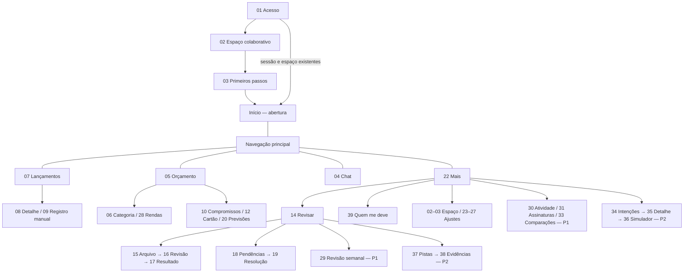

# Planejamento das telas — Controle financeiro colaborativo

> **Validação vigente — 09/11/2026 (`accord-rub9`):** MainActivity fixa em retrato; validar em retrato e fonte padrão, com teclado, temas, TalkBack e movimento reduzido. Por decisão explícita do usuário, paisagem e fonte a 200% deixam de ser critérios de aceite ou etapas dos roteiros. Referências anteriores a essa matriz são históricas, não exigências atuais. Isso não comprova validação nem remove as adaptações de acessibilidade existentes.

Revisão: **23/10/2026**, conferida contra o código e os ADRs em **10/11/2026** (`accord-yxcd`) · **39 telas numeradas + Início + este índice** · Idioma: português brasileiro.  
Status: especificação de UX. Cada tela diz o que já está no aplicativo e o que é alvo; nada aqui é teste de desempenho concluído nem validação nos Galaxy S20 FE e S23 FE (o que foi visto só no emulador está dito como tal).

Este diretório descreve a funcionalidade, o comportamento e os estados de cada tela. Planos ficam
em [`docs/specs/plans`](../specs/plans/README.md); specs de mudanças por funcionalidade ficam em
[`docs/specs`](../specs/README.md). Uma mudança posterior recebe nova spec e não substitui o
registro anterior.

## 1. Como usar

**Auditoria de UI de 06/11/2026:** consultar o
[complemento visual e protocolo de evidência](auditoria-ui-2026-11.md) e o complemento ao
final de cada tela 01–28. Por orientação do usuário, registrar a proposta na spec **antes de
qualquer nova alteração de UI**. O complemento distingue correções documentadas
retrospectivamente de propostas especificadas antes da implementação.

Cada arquivo descreve uma tela completa e pode ser usado isoladamente para orientar um protótipo ou sua implementação. Contém contexto, entradas e saídas, wireframe, campos, interações, estados, regras, acessibilidade, aceite e dependências. Criar/editar compartilham documento quando o layout é o mesmo. Diálogos, seletores, filtros e erros pertencem à tela responsável.

Para trabalhar com uma tela, abrir seu arquivo e seguir sua prioridade e dependências. Os links servem para conferir continuidade, sem exigir leitura do índice para compreender a tela. Não implementar recursos P1/P2 como dependência escondida de P0.

### Origem e autoridade das decisões

- **Requisitos do produto:** documento fornecido `plan.md`, revisão de 22/10/2026, título “Plano — Controle financeiro do casal”. As seções de origem aparecem em cada tela.
- **Decisões de UX aprovadas nesta conversa:** cobertura P0/P1/P2, uma tela por arquivo, arquivos autossuficientes, detalhamento completo, aparência simples e acolhedora e Início como tela inicial (09/11/2026, ADR 0067).
- **Decisões posteriores confirmadas:** login por e-mail e senha; todos os membros podem criar e editar lançamentos, categorias, limites e configurações; até quatro membros associados por código multiuso ou QR Code; seleção de banco por lista com ícones; limite da categoria principal divisível entre suas subcategorias, sem aumentar o total; histórico de Chat apenas no aparelho de origem. A divisão substitui a decisão anterior de não configurar valores por subcategoria.
- **Alertas:** destinados a todos os membros, com no máximo um evento por categoria de segunda a domingo. A janela vai de segunda às 00h até a segunda seguinte às 00h, limite final exclusivo, no fuso de referência America/Sao_Paulo. Respeitar preferências e permissões dos aparelhos; renovar a janela não agenda um aviso automático.
- A [cópia revisada do plano de desenvolvimento](../specs/plans/plano-desenvolvimento.md) incorpora essas escolhas. O documento original em Downloads foi preservado.
- **Propostas de UX:** tema conforme o sistema, medidas de referência e tratamentos ainda não definidos pelo produto estão rotulados como proposta quando alteram política.
- **Pendências:** não são requisitos aprovados; precisam ser resolvidas antes de implementar o comportamento afetado.
- SHA-256 do documento de desenvolvimento consultado: `309330b42adcb342b0181fbbdbd7fe0001f7dd450da27b213467edd459a343ac`. O original foi apenas lido.

## 2. Público, objetivos e limites do produto

Aplicativo Android de controle financeiro colaborativo para até quatro pessoas, com contas individuais, orçamento e limites compartilhados (ADR 0053). Compatibilidade: Android 10/API 29 ou superior. Os modelos do piloto são referências de validação, não restrições de compatibilidade. Eventual SLM exige medição própria de memória, consumo e estabilidade. Registrar deve ser rápido, corrigir deve ser fácil e uma interrupção não deve impedir a retomada.

P0 entrega o ciclo **registrar → acompanhar → importar → conferir → retomar**. P1 acrescenta análise e revisão. P2 acrescenta intenções, simulações e pistas. A validação de qualidade e desempenho do modelo nos dois aparelhos continua pendente; os aparelhos do piloto são referências de validação.

**Tecnologia confirmada pelo usuário:** Android nativo com Kotlin e Jetpack Compose. O modelo será baixado separadamente no primeiro uso, com tamanho real e progresso visíveis e alternativa manual durante o download. Cada celular instala sua cópia e interpreta localmente sem internet após instalar. Motor de inferência, modelo, quantização e hospedagem dos pesos continuam pendentes de validação; a forma de distribuição está decidida. A implementação deverá preservar os critérios de acessibilidade, temas, navegação e estados descritos em cada tela.

**Meta de resposta confirmada:** até 5 segundos para interpretar uma frase curta no Chat e mostrar o resultado, com o modelo já carregado. Download, abertura/carregamento inicial do modelo e sincronização ficam fora dessa medida e devem ser medidos separadamente. Validar nos dois celulares; ainda não houve comprovação de desempenho. A meta não define um cancelamento automático ao atingir 5 segundos: preservar a mensagem e manter alternativa manual se houver demora.

**Limite de download confirmado:** até 2 GB por celular para o conjunto de arquivos do modelo escolhido. Esse teto orienta a avaliação de candidatos; não comprova qualidade ou tempo de resposta. Mostrar o tamanho real, separado do espaço necessário para instalar e do consumo de RAM, ainda a medir. Convenção de exibição: GB decimal (2 GB = 2.000.000.000 bytes).

Não fazem parte deste planejamento Open Finance, mensageria externa, investimentos, múltiplas famílias, gastos privados, cotas individuais, reembolsos com terceiros, divisão obrigatória de compras por item, gamificação punitiva ou IA remota automática.

## 3. Mapa de navegação

| Aba | Tela raiz | Destinos e responsabilidades |
|---|---|---|
| Lançamentos | [07 — Lançamentos](07-lancamentos.md) | Busca e filtros, detalhe 08 e novo/edição 09. |
| Orçamento | [05 — Orçamento mensal](05-orcamento-mensal.md) | Categoria 06, próximos meses 10, cartão 12, previsões 20 e rendas 28. Compromisso 11 e fatura 13 aprofundam a composição. Remodelagem (resumo enxuto, categorias primeiro, detalhes recolhidos, "Editar limites" no Orçamento e na categoria): [ADR 0086](../adr/0086-remodelagem-da-tela-orcamento.md), aceita em 10/11/2026, ainda não implementada. |
| Chat | [04 — Chat](04-chat.md) | Registro por conversa; ícone Astroid sem rótulo visual; recibos em 08; formulário em 09; modelo em 25; sincronização em 26. |
| Início | [Início](inicio.md) | Abertura: Saldo total, faixa “Pede atenção” (Revisar, datas dos próximos 7 dias, estouro), margem para gastar e previsão do mês; registro manual pelo botão flutuante. **Remodelagem aceita e implementada em 10/11/2026 ([ADR 0078](../adr/0078-remodelagem-da-tela-inicio.md)), validada só no emulador; Galaxy e TalkBack em `accord-4uu2`.** Revisar fica em Mais: pendências 18–19 e pistas 37–38/P2. A importação 15–17 abre por "Importar do banco", outra linha de Mais. |
| Mais | [22 — Mais e configurações](22-mais-e-configuracoes.md) | Espaço/checklist 02–03, painel Gerenciar contas com banco/apelido/padrão, configurações 23–27 e recursos de análise/planejamento da fase disponível. Cabeçalho + grupos (Revisar e importar, Orçamento e contas, Planejar com Quem me deve, Acompanhar, Neste aparelho, Aplicativo, Conta): [ADR 0077](../adr/0077-reagrupamento-da-aba-mais.md), aceito e implementado em 10/11/2026 (fatias A–E), validação visual e TalkBack em `accord-khux`. |

A barra inferior aparece nas cinco raízes, nesta ordem: Início, Lançamentos, Chat, Orçamento e Mais (ADR 0071). Chat usa o ícone Astroid em um FAB encaixado no centro da barra, sem texto visível, mas mantém seu nome acessível. Fluxos e detalhes usam voltar com preservação de contexto; formulários podem priorizar teclado e ação fixa sem uma segunda navegação principal. Links de notificação abrem o detalhe correspondente, com caminho de volta ao grupo de origem. Fases futuras não aparecem como controles funcionais antes de disponíveis.

Adaptação para texto ampliado (26/10/2026): com escala de fonte a partir de 150% e teclado aberto,
a barra usa ícones com nomes acessíveis completos para preservar espaço de conversa e ações.
Ao fechar o teclado, os rótulos visuais retornam e a altura acompanha seu conteúdo, sem corte.
Evidência e limites: [validação do piloto no emulador](../poc/ui-classificacao-assistida-emulador.md).

## 4. Índice dos arquivos

**P0:** 28 telas · **P1:** 5 telas · **P2:** 5 telas.

| ID | Fase | Arquivo de tela |
|---|---|---|
| 01 | P0 | [Acesso](01-acesso.md) |
| 02 | P0 | [Espaço colaborativo](02-espaco-do-casal.md) |
| 03 | P0 | [Primeiros passos](03-primeiros-passos.md) |
| 04 | P0 | [Chat](04-chat.md) |
| 05 | P0 | [Orçamento mensal](05-orcamento-mensal.md) |
| 06 | P0 | [Categoria no mês](06-detalhe-categoria.md) |
| 07 | P0 | [Lançamentos](07-lancamentos.md) |
| 08 | P0 | [Detalhe do lançamento](08-detalhe-lancamento.md) |
| 09 | P0 | [Registro manual e edição](09-registro-manual.md) |
| 10 | P0 | [Compromissos futuros](10-compromissos-futuros.md) |
| 11 | P0 | [Detalhe do compromisso](11-detalhe-compromisso.md) |
| 12 | P0 | [Cartão e faturas](12-cartao-e-faturas.md) |
| 13 | P0 | [Detalhe da fatura](13-detalhe-fatura.md) |
| 14 | P0 | [Retomar o controle](14-retomar-controle.md) |
| 15 | P0 | [Importar arquivo](15-importar-arquivo.md) |
| 16 | P0 | [Revisar importação](16-revisar-importacao.md) |
| 17 | P0 | [Resultado da importação](17-resultado-importacao.md) |
| 18 | P0 | [Pendências](18-pendencias.md) |
| 19 | P0 | [Resolver pendência](19-resolver-pendencia.md) |
| 20 | P0 | [Previsões e alertas](20-previsoes-e-alertas.md) |
| 21 | P0 | [Detalhe da previsão](21-detalhe-previsao.md) |
| 22 | P0 | [Mais e configurações](22-mais-e-configuracoes.md) |
| 23 | P0 | [Categorias e subcategorias](23-categorias-e-subcategorias.md) (remodelagem aceita, não implementada: [ADR 0084](../adr/0084-remodelagem-da-tela-categorias.md)) |
| 24 | P0 | [Limites do orçamento](24-limites-do-orcamento.md) |
| 25 | P0 | [Modelo no aparelho](25-modelo-no-aparelho.md) |
| 26 | P0 | [Sincronização](26-sincronizacao.md) |
| 27 | P0 | [Preferências de alertas](27-preferencias-de-alertas.md) |
| 28 | P0 | [Rendas](28-rendas.md) |
| 29 | P1 | [Revisão semanal](29-revisao-semanal.md) |
| 30 | P1 | [Atividade de compras](30-atividade-de-compras.md) |
| 31 | P1 | [Assinaturas](31-assinaturas.md) |
| 32 | P1 | [Detalhe da assinatura](32-detalhe-assinatura.md) |
| 33 | P1 | [Comparações históricas](33-comparacoes-historicas.md) |
| 34 | P2 | [Intenções de compra](34-intencoes-de-compra.md) |
| 35 | P2 | [Detalhe e edição da intenção](35-detalhe-intencao.md) |
| 36 | P2 | [Simulador de compra](36-simulador-de-compra.md) |
| 37 | P2 | [Pistas de revisão](37-pistas-de-revisao.md) |
| 38 | P2 | [Detalhe da pista](38-detalhe-pista.md) |
| 39 | fora da numeração P0/P1/P2; [ADR 0083](../adr/0083-quem-me-deve.md) aceito em 10/11/2026, implementada e testada só no emulador (`accord-oldt.6` pendente) | [Quem me deve](39-quem-me-deve.md) |

## 5. Fluxos principais e resultados esperados

1. **Primeiro acesso:** 01 → 02 → 03 → 04. Cartão, convite, limites e modelo têm configuração retomável. Modelo indisponível oferece 09; não exige que os dois participem ao mesmo tempo.
2. **Registro claro:** 04 → ação validada → recibo → 08 ou 09. Salvar diretamente, com editar e desfazer; não inserir confirmação redundante.
3. **Dúvida:** 04 → pergunta → 18 → 19. Sair não perde a mensagem nem efetiva ação inválida.
4. **Conferir orçamento:** 05 → 06 → 07 → 08; cartão 12 → fatura 13; compromisso 10 → 11. Totais levam às suas origens.
5. **Retomar:** 14 → 15 → 16 → 19 quando necessário → 17 → 18 para o restante. Reabrir o resultado não reaplica a importação.
6. **Trabalhar offline:** 04/09 salva localmente → 26 identifica fila → sincronização autenticada quando houver conexão. Identificadores estáveis impedem duplicação.
7. **Prever:** 20 → 21 → movimentos de origem. Valores conhecidos e estimados são separados; recálculo não ignora o limite semanal de avisos.
8. **Revisar P1:** 29 reúne desvios e próximos compromissos; 30 e 33 analisam os mesmos movimentos por critérios explícitos; 31 → 32 revisa assinaturas.
9. **Planejar P2** (telas 34 a 38 implementadas atrás da fase P2; pistas validadas só no emulador e no S20 FE em pacote isolado, o resto sem validação nos aparelhos): 34 → 35 → 36. Simular não altera orçamento. Assumir compromisso abre 09; só salvar validamente cria o compromisso e vincula a intenção.
10. **Avaliar pista P2:** 37 → 38 → 08/19 para evidências. Dispensar a pista não exclui nem estorna gastos.

## 6. Regras comuns de dados e linguagem

| Conceito | Significado e apresentação |
|---|---|
| Comprometido | Despesas/compromissos assumidos atribuídos ao mês pelo motor financeiro; não inclui intenção de compra nem novos variáveis apenas estimados. |
| Pago | Parte quitada dos compromissos, líquida dos estornos confirmados do mês (decisão de 23/10/2026); não somar novamente ao comprometido. Pagamento de fatura não é nova despesa por categoria. |
| Quitação da fatura no P0 | Aceitar apenas integral, com total/vínculo conferidos. Parcial ou divergente fica em revisão com valor real preservado; sem baixa parcial, quitação automática ou despesa fictícia para fechar diferença. A restrição é de fatura, não de todo movimento. |
| Renda recebida | Valor efetivamente recebido; renda ainda prevista é apresentada separadamente, sem virar saldo confirmado. |
| Categoria/subcategoria | Um movimento em uma subcategoria integra sua categoria uma vez. Categoria predominante para compras variadas. Assinaturas ficam em Assinaturas. |
| Limite | Total compartilhado da categoria principal, com divisão opcional entre subcategorias. Valores distribuídos são partes do mesmo limite e não aumentam o total geral. Excesso não aumenta limite nem transfere orçamento automaticamente. |
| Histórico do Chat | Fica local no aparelho e não é sincronizado. Os registros financeiros continuam compartilhados e editáveis por todos os membros. |
| Estorno confirmado | Crédito vinculado à compra; reduz gasto da categoria no mês da fatura que recebe o crédito ou na data da devolução efetiva nos demais pagamentos. Preserva a compra original e não é renda. |
| Cancelamento parcelado | Manter parcelas futuras até confirmar que não serão cobradas. Depois retirar somente as confirmadas, com histórico preservado e sem gerar estorno extra automaticamente. |
| Juros, multas e tarifas | Despesas confirmadas em Serviços > Tarifas e juros, permitindo corrigir a classificação. Integram fatura e categoria uma vez; a subcategoria pode receber parte do limite de Serviços. Não projetar encargos bancários ainda não confirmados. |
| Banco | Seleção por lista pesquisável com ícone e nome; ícone genérico se não houver ativo oficial validado; opção Outro banco. Não é integração bancária. |
| Arquivo importado | Não reter cópia permanente do PDF/OFX; guardar dados extraídos e informações originais dos movimentos, metadados e decisões. Temporários de leitura são descartados, sem alterar o arquivo externo selecionado. Nova leitura exige nova seleção do arquivo. |
| PDF no P0 | Apenas PDFs bancários exportados com texto selecionável dos movimentos, com compatibilidade a validar. PDF digitalizado/imagem que exige OCR fica fora da primeira versão; oferecer outro PDF ou OFX, sem fallback para IA visual. |
| Conta de origem/destino | Cadastro compartilhado com banco e apelido; cada pessoa escolhe seu próprio padrão corrigível para Pix, boletos e renda. Trocar seu padrão não altera o da outra pessoa, não reatribui registros antigos nem cria saldo bancário ou orçamento individual. |
| Data da compra | Momento do comportamento de compra, usado na atividade P1. Compra parcelada aparece pelo total original uma vez nessa perspectiva. |
| Mês do orçamento | Cartão usa vencimento da fatura efetivamente atribuída; parcelas ocupam cada fatura. Pix usa data da movimentação. Boleto não pago é previsto pelo vencimento; pago ocupa só o mês do pagamento efetivo, removendo a previsão anterior. |
| Fatura estimada / a conferir | Salvar diretamente no mês estimado quando só a fatura estiver incerta perto do fechamento; marcar “a conferir” e permitir correção posterior no mesmo movimento, recalculando os meses sem duplicação. Fechamento dia 8 e vencimento dia 15 são referências, não garantia do emissor. |
| Pendência | Dúvida preservada para revisão; não inventar campos faltantes nem declarar cobertura completa. Rascunho inválido não é ação financeira efetivada. |
| Conferido | Trabalho de verificação concluído no contexto informado; difere de pago e de sincronizado. |
| Sincronizado | Operações reconhecidas pelo serviço até a data conhecida; não garante que o outro aparelho não tenha novos registros offline. |
| Conflito de edição | Mostrar as duas versões, sem pré-seleção, e pedir escolha de qual manter. Não vencer automaticamente pela data nem mesclar. As duas versões do mesmo movimento não viram duas despesas. |
| Custo de login/sincronização | Buscar opção sem mensalidade; verificar condições/limites antes de escolher. Se exigir pagamento, rever a solução com o usuário, sem ativar cobrança automaticamente. Gratuidade não é garantia permanente do fornecedor. |
| Serviço escolhido | Supabase hospedado no plano Free: Auth para e-mail/senha e PostgreSQL para dados financeiros. Banco/fila locais, idempotência e conflitos manuais pertencem à implementação do app; não sincronizar mensagens do Chat nem PDFs/OFX completos. |
| E-mails no piloto | Não haverá envio de e-mails pelo aplicativo. Login/cadastro continuam por e-mail e senha, sem confirmação por mensagem; convite é por código. Sem SMTP ou recuperação automática. Ajuda orienta redefinição assistida fora do aplicativo. |
| Estimativa | Valor calculado para gastos variáveis adicionais, distinguível dos compromissos já incluídos. |
| Intenção/cenário | Ideia ou simulação que não ocupa orçamento; conversão explícita e válida pode gerar um compromisso real. |

O SLM local interpreta mensagens. O aplicativo valida ações, calcula centavos/parcelas/totais e executa consultas controladas. Não enviar automaticamente texto ou arquivos para IA externa nem entregar cálculos ao modelo. Consulta financeira por Chat é P1; registro conversacional é P0.

## 7. Exemplos de referência

Todos os valores são fictícios. As telas mostram estados específicos; um exemplo de lançamento novo não está implicitamente incluído nos totais de outra tela.

| Categoria | Limite em outubro | Comprometido em outubro |
|---|---:|---:|
| Alimentação | R$ 1.200,00 | R$ 980,00 |
| Compras | R$ 400,00 | R$ 100,00 |
| Assinaturas | R$ 150,00 | R$ 120,00 |
| Lazer | R$ 300,00 | R$ 180,00 |
| Pet | R$ 250,00 | R$ 150,00 |
| Serviços | R$ 300,00 | R$ 180,00 |
| Casa | R$ 1.100,00 | R$ 1.000,00 |
| Saúde | R$ 200,00 | R$ 90,00 |
| Transporte | R$ 300,00 | R$ 200,00 |
| Eletrônicos | R$ 300,00 | R$ 200,00 |
| **Total** | **R$ 4.500,00** | **R$ 3.200,00** |

- Pago no exemplo mensal: R$ 1.000,00, já contidos nos R$ 3.200,00. Alimentação: R$ 300,00 pagos, também como subconjunto.
- Alimentação: Delivery R$ 280 + Mercado R$ 500 + Restaurantes R$ 200 = R$ 980; restante R$ 220 contra limite R$ 1.200.
- Renda: R$ 6.000 recebidos + R$ 500 ainda a receber = R$ 6.500 esperados.
- Previsão ilustrativa: R$ 980 conhecidos + R$ 320 variáveis estimados = R$ 1.300; possível excesso R$ 100 contra limite R$ 1.200.
- Compra real de exemplo: equipamento em 25/09/2026, R$ 1.200 em 6 × R$ 200, primeira fatura confirmada em outubro/2026; última em março/2027. Atividade de setembro vê R$ 1.200 uma vez.
- Cenário independente: televisão de R$ 1.200 em 6 × R$ 200, primeira fatura simulada em novembro/2026; última em abril/2027. Não altera os meses reais.
- Registro por Chat em 22/10/2026: delivery de R$ 68 no cartão pode sugerir novembro, sujeito à atribuição do emissor.
- Importação: 12 movimentos = 7 novos + 3 vinculados + 2 pendências. Dez itens conferidos não tornam o intervalo completo enquanto houver dúvidas relevantes.
- Boleto de R$ 100 que vence em outubro e é pago em novembro: antes do pagamento, previsão R$ 100 em outubro; depois, R$ 0 desse boleto em outubro e R$ 100 pagos em novembro. Vencimento e data efetiva são preservados. Antecipar de novembro para outubro aplica a mesma regra, em sentido inverso.
- Estorno de exemplo: compra de R$ 100 em outubro e devolução efetiva em novembro mantêm a despesa original em outubro e um crédito de R$ 100 na categoria de origem em novembro. No cartão, usar o mês de vencimento da fatura que recebe o crédito. Crédito parcial de R$ 40 abate R$ 40, sem assumir devolução integral. Crédito apenas solicitado não é confirmado.
- Cancelamento de exemplo: após duas parcelas de seis, um pedido de cancelamento mantém as quatro futuras previstas. Somente a confirmação de que não serão cobradas retira essas quatro do orçamento; as duas anteriores e os créditos efetivamente registrados permanecem rastreáveis, sem estorno fictício pela mera retirada das futuras.
- Assinatura: R$ 34,90 → R$ 39,90 = R$ 5,00 de diferença observada. Comparação de Alimentação: R$ 800 → R$ 980 = R$ 180 / 22,5%.

## 8. Direção visual e componentes recorrentes

**Redesign de 25/10/2026:** a [direção visual implementada](../branding/redesign-2026-10/README.md)
e os [tokens atuais](../design-tokens.md) atualizam cores, tipografia, cantos, agrupamentos e
cabeçalhos das telas Compose. Os wireframes das specs continuam como referência de conteúdo e
comportamento; sua composição visual não é rígida. Estados e regras financeiras permanecem.
O [refinamento com referências do Dribbble](../branding/dribbble-2026-10/README.md) registra
as fontes e a evolução aplicada às telas financeiras e ao Chat na mesma data.
O [guia carvão e amarelo suave](../branding/carvao-2026-10/README.md) registra a rodada
seguinte com as referências locais escolhidas pelo usuário: navegação compacta, botão “+”
flutuante, pesquisa e aplicação uniforme ao Android, preservando à época o Chat como início (substituído pelo ADR 0067).

**Remodelagem de cores aceita, ainda não implementada (10/11/2026, `accord-9rjk`, [ADR 0085](../adr/0085-remodelagem-de-cores-e-camadas.md), accepted):** a [spec](remodelagem-cores-2026-11.md) descreve o alvo (marca azul, cartões com borda, receita verde e despesa vermelha fixas, contrato das sete paletas); não está implementada, e o parágrafo acima segue vigente até a implementação.

- **Tom:** claro, calmo e sem julgamento. Preferir “Podemos conferir este gasto?” a acusações; não culpar por lacunas nem chamar assinatura de inútil.
- **Temas:** claro e escuro, com preferência Sistema como padrão. Usar tokens semânticos de fundo, superfície, texto, ação, atenção, erro e sucesso; não fixar cores independentes por tela. Valores implementados em [Tokens de design](../design-tokens.md).
- **Hierarquia:** tipografia nativa, corpo de referência 16 sp, títulos 20–24 sp, valores tabulares quando disponíveis; margens 16 dp e ritmo 4/8 dp. São referências adaptáveis ao tamanho de texto, não alturas rígidas.
- **Componentes:** cabeçalho, barra inferior nas raízes, cartões de resumo, linha de movimento, recibo do Chat, seletor de mês, barra de categoria, aviso de cobertura, estado de sincronização e painéis de edição/filtro.
- **Iconografia confirmada em 23/10/2026:** [Lucide](https://lucide.dev/guide/) para a interface e [logos-bancos-br](https://github.com/rzmt/logos-bancos-br) para os bancos. Integração prevista no Android pela biblioteca comunitária [Compose Icons](https://github.com/composablehorizons/compose-icons#lucide), artefato `com.composables:icons-lucide-android`, com vetores XML. Fixar a versão na implementação após verificar compatibilidade; nenhuma biblioteca foi instalada nesta tarefa de documentação.
- **Catálogo bancário local:** copiar os dados e PNG/SVG necessários de logos-bancos-br durante a preparação do aplicativo, mantendo identificadores ISPB/COMPE e origem dos arquivos. Não executar o pacote JavaScript no celular nem depender de CDN para mostrar bancos. O catálogo é comunitário e informa fontes oficiais; não é publicado pelo Banco Central e não comprova suporte de importação. Logo ausente usa símbolo bancário genérico do Lucide com nome. Preservar cores e proporção dos logos nos dois temas.
- **Ação:** uma ação principal por estado, feedback imediato, sem mudança de posição no toque. Salvar localmente e enviar ao outro aparelho têm feedback separado.
- **Acessibilidade:** 48 × 48 dp, contraste de texto 4,5:1 e gráficos essenciais 3:1; ícone/texto além da cor; foco lógico, TalkBack, fontes ampliadas, movimento reduzido e teclado sem encobrir ações.
- **Gráficos:** barras e séries simples, com valores exatos e alternativa textual. Critério de data e unidade sempre explícitos.
- **Persistência:** rascunhos e decisões parciais são recuperáveis; erro ou cancelamento não apaga trabalho confirmado. Fluxos respeitam voltar do Android e restauram rolagem/filtros.

## 9. Decisões abertas e tratamento nas telas

- **acesso:** Confirmados: Supabase Auth para e-mail/senha, acesso igual e convite por código. Piloto sem envio de e-mails: não exigir confirmação por e-mail, não oferecer recuperação automática nem configurar SMTP. E-mail é identificador de login, sem prova de posse verificada. Esquecimento de senha terá atendimento manual fora do app, pelo responsável pela operação do piloto. Implementar/testar cadastro, login e associação sem disparar e-mails; nenhuma configuração foi executada nesta tarefa.
- **sync:** Confirmados: Supabase hospedado no plano Free, com PostgreSQL para os dados financeiros, mantendo banco e fila locais no aplicativo. Conflitos exigem escolher entre duas versões; repetição de operação não duplica movimentos. Implementar e testar o protocolo de sincronização; Realtime não substitui persistência/fila nem a política de conflitos. Manter a restrição de custo sem mensalidade: rever se exigir pagamento, sem ativar cobrança automaticamente.
- **modelo:** Confirmados: Android nativo com Kotlin e Jetpack Compose; modelo baixado separadamente no primeiro uso, com limite de até 2 GB por celular, tamanho real e progresso visíveis e registro manual disponível durante o download. Após instalar, a interpretação funciona localmente sem internet. Meta confirmada: até 5 segundos para interpretar frase curta e mostrar o resultado, com modelo já carregado; exclui download, abertura do modelo e sincronização. São critérios para avaliar candidatos nos dois celulares, ainda sem desempenho comprovado. Pendentes no plano original (§§7 e 13): modelo, motor, quantização, hospedagem dos pesos, tamanho efetivo do candidato, critérios de qualidade/memória e requisitos dos aparelhos. O limite do download não define RAM nem espaço final de instalação. Exibir tamanho real antes de baixar e progresso mensurável durante a transferência; não inventar números nem anunciar desempenho já validado.
- **boleto:** Confirmado pelo usuário: enquanto não pago, o boleto é previsto no mês do vencimento. Ao registrar o pagamento, ele passa a consumir somente o mês do pagamento efetivo; remover a previsão anterior sem duplicar o gasto. Preservar vencimento original e data real de pagamento. Exemplo: vence em outubro e é pago em novembro → deixa de ocupar outubro e passa a ocupar novembro. Vale também para antecipação.
- **estorno:** Confirmados: estorno abate no período do crédito, vinculado à compra e sem virar renda; futuras canceladas permanecem previstas até confirmar não cobrança, sem estorno extra automático; encargos reais ficam em Serviços > Tarifas e juros, corrigíveis. Na primeira versão, fatura aceita somente quitação integral; pagamento parcial ou divergente fica para revisão, sem baixa automática. Preservar o valor real informado/importado e não substituí-lo pelo total só para concluir. Ajustes não identificados exigem revisão. Excluir cadastro não equivale a estornar.
- **origem:** Confirmado: contas simples com banco e apelido; cada pessoa escolhe sua própria conta padrão, corrigível no registro, para Pix, boletos e renda. Usar o padrão de quem está registrando, salvo conta explicitamente informada. Contas e orçamento são compartilhados; o padrão é preferência individual de preenchimento, sem limite ou orçamento individual e sem conexão bancária ou saldo automático.
- **fechamento:** Confirmado: quando houver dúvida sobre a fatura perto do fechamento, salvar o lançamento na fatura estimada e marcar “a conferir”, permitindo corrigir depois. Incluir provisoriamente no mês estimado com sinalização; ao conferir, corrigir o vínculo e recalcular os meses envolvidos sem duplicar a compra. Isso não autoriza inventar valor ou categoria. Dia 8 não garante a atribuição do emissor.
- **importacao:** Confirmados: Itaú como prioridade para validar a importação no piloto, cobrindo fatura do cartão e extrato da conta; seleção de banco em lista com ícones continua disponível. Validar cada tipo e os formatos que o banco efetivamente disponibilizar, sem prometer PDF e OFX para ambos antes da conferência. Amostra example.ofx serve para inspeção estrutural, sem comprovar origem Itaú ou compatibilidade com esse banco. Sem cópia permanente de PDF/OFX, mantendo dados extraídos, campos originais e metadados. PDF no P0 somente bancário exportado com texto selecionável; OCR e PDF digitalizado/imagem ficam fora da primeira versão. Arquivo externo permanece intacto. Amostra OFX é EUR e de conta; ainda pendentes amostras representativas em BRL de fatura e extrato Itaú, identificação de layouts/produtos específicos, compatibilidade efetiva e bibliotecas de extração.
- **alertas:** Confirmado: os dois recebem alertas, respeitando preferências e permissões de cada aparelho. A janela semanal é fixa, de segunda a domingo: segunda às 00h até a segunda seguinte às 00h, limite final exclusivo, no fuso de referência do orçamento America/Sao_Paulo. No máximo um evento por categoria nessa janela, destinado aos dois. A renovação permite um novo aviso se houver motivo, sem agendar envio automático à meia-noite. A coordenação dos aparelhos depende da solução de sincronização.

**Vigência dos limites confirmada:** a cada edição, escolher entre somente o mês selecionado ou esse mês e os seguintes. O seletor explicita mês/ano e categorias afetadas antes de salvar; meses anteriores à referência e categorias não editadas permanecem iguais. A opção de um único mês preserva a configuração anterior dos meses seguintes. As telas 05, 06, 20, 21 e 24 devem usar os limites correspondentes a cada mês ao recalcular os indicadores.

**Divisão do limite confirmada nesta revisão:** o limite pertence à categoria principal e pode ser repartido total ou parcialmente entre subcategorias. Exemplo: Alimentação R$ 1.200 = Delivery R$ 400 + Mercado R$ 500 + R$ 300 sem distribuir. O total de limites do espaço continua R$ 4.500 no exemplo mensal; não somar os R$ 900 distribuídos novamente. Essa escolha substitui a decisão anterior de não oferecer valores por subcategoria. Soma distribuída não pode superar o limite principal. Sem distribuir representa valor ainda não destinado; com gastos de R$ 980, o restante da categoria é R$ 220, distinto dos R$ 300 sem distribuir. Subcategoria sem divisão continua compondo o consumo da categoria, sem limite zero presumido ou redistribuição automática. Os alertas permanecem por categoria principal, sem novas cotas por subcategoria.

**Edição de despesas recorrentes confirmada:** escolher em cada edição Só esta ocorrência ou Esta e as próximas, preservando as anteriores. Identificar ocorrência, alcance e efeito antes de salvar; uma mudança pontual não altera o padrão futuro. Preservar identidade e vínculos da série, pagamentos realizados e informações originais importadas. A escolha é para recorrências e não define automaticamente como editar parcelas de uma compra finita.

**Período da Revisão semanal confirmado:** abrir na última semana completa de segunda a domingo, com datas explícitas e seleção de outros períodos, em America/Sao_Paulo. Exemplo: consulta em 22/10/2026 abre 12–18/10/2026; nova revisão em 26/10 abre 19–25/10/2026. Retomar uma revisão preserva o período em andamento. O período consultado não altera limites mensais nem a janela dos alertas.

**Intenções de compra compartilhadas confirmadas (P2):** lista do espaço, com acesso igual para todos os membros verem e editarem. Sincronizar intenções salvas, preservando identidade e revisando conflitos; o Chat continua local. Criar, editar e simular não afeta limites reais. A conversão explícita deve gerar um único compromisso vinculado à intenção, inclusive diante de tentativas nos dois aparelhos.

**Correção de compras parceladas confirmada:** categoria e descrição são corrigidas sempre em todas as parcelas da mesma compra, inclusive anteriores, atuais e futuras. Mostrar o alcance antes de salvar, preservar valores, datas, pagamentos e originais importados, e recalcular os indicadores afetados. Não oferecer edição isolada de uma parcela para esses dois campos. Correção de valor, datas, cancelamento e pagamento seguem suas próprias validações; essa decisão não autoriza alterá-los em lote.

Dependências de validação ainda abertas: obter amostras representativas de fatura/extrato Itaú; verificar hardware nos aparelhos; medir desempenho, memória e qualidade do modelo; escolher modelo/motor/quantização, hospedagem dos pesos e bibliotecas de importação com base nos resultados. Os serviços e fluxos definidos ainda precisam de implementação e testes. O próximo insumo documental é uma fatura Itaú em PDF bancário com texto selecionável; depois, validar o extrato da conta e os formatos disponibilizados para cada tipo.

### Amostra OFX recebida e inspecionada

**Prioridade de validação confirmada:** Itaú, cobrindo **fatura do cartão e extrato da conta** no piloto. Obter amostras representativas em BRL para ambos e testar separadamente os formatos que o banco disponibilizar, sem prometer PDF e OFX para cada tipo antes da validação. A seleção de bancos por lista com ícones permanece prevista. Essa prioridade não comprova compatibilidade nem define o banco de todos os registros; a amostra abaixo não foi identificada como arquivo do Itaú. Compras da fatura são despesas; débito de quitação no extrato deve ser vinculado ao pagamento, sem duplicar essas despesas.

`example.ofx` contém dez movimentos (dois positivos e oito negativos), com moeda **EUR**, idioma declarado FRA e período declarado de 01/10/2015 a 13/04/2016. A estrutura é de extrato de conta, não fatura de cartão. Há um FITID repetido em dois movimentos com valores e datas diferentes. Não identificar o banco dos membros do espaço nem classificar renda/cartão apenas com esses dados.

Isso valida uma amostra para inspeção estrutural, não a compatibilidade do aplicativo, cujo parser ainda não foi implementado. Na versão BRL, a confirmação de moeda não suportada deve ser bloqueada, preservando a moeda original na prévia. O identificador repetido deve gerar revisão, não descarte automático. O cenário de 12 itens das telas é fictício e distinto desta amostra real de 10 itens.

SHA-256 da amostra inspecionada: `ad568ea62861999daa1920d87d774274936319491988873eb433f8459c79541e`.

### Supabase — decisão confirmada e implementação pendente

Usar Supabase hospedado no plano Free, com Auth e PostgreSQL. Proposta técnica para implementar a escolha: banco e fila locais, operações com identificadores estáveis, validação de versão no serviço e conflito preservado para escolha. Permissões por espaço devem ser verificadas no banco; código de convite não pode ser validado só no cliente. Não colocar credenciais administrativas no aplicativo. Esquema, migrações, regras de acesso e protocolo ainda precisam de implementação e testes.

Condições consultadas em 22/10/2026: o plano Free possui limites e pode pausar por baixa atividade. Não trocar para plano pago automaticamente. Nenhum projeto Supabase ou provedor de e-mail foi criado/configurado nesta tarefa.

O usuário confirmou que não possui domínio próprio, não quer comprar e não haverá envio de e-mails no piloto. Remetente/SMTP não são pendências desse piloto. No Supabase Auth, planejar Confirm Email desativado e não chamar envios de confirmação, recuperação ou convite. E-mail continua como identificador, sem afirmar posse verificada. Ajuda no login orienta atendimento manual fora do aplicativo; redefinição administrativa usa ambiente confiável, nunca uma chave administrativa no cliente. A implementação e seus testes continuam pendentes.

Referências oficiais: [plano Free](https://supabase.com/pricing), [pausa de projetos](https://supabase.com/docs/guides/platform/free-project-pausing), [login por senha](https://supabase.com/docs/guides/auth/passwords), [configuração de confirmação](https://supabase.com/docs/guides/auth/general-configuration), [administração de usuário](https://supabase.com/docs/reference/javascript/auth-admin-updateuserbyid), [permissões no banco](https://supabase.com/docs/guides/database/postgres/row-level-security) e [funções do banco](https://supabase.com/docs/guides/database/functions).

A divergência original sobre boletos foi resolvida pelo usuário: **enquanto não pago, prever pelo vencimento; ao pagar, consumir somente o mês do pagamento efetivo**. Remover a previsão anterior sem duplicar o movimento e preservar as duas datas. Essa decisão substitui as propostas anteriores das seções 2, 4.1 e 11 do documento-base.

## 10. Conferência dos documentos e aceite futuro

Conferência documental de 22/10/2026 (no diretório hoje há também 39, Início, a auditoria de UI e a spec de cores): 39 arquivos Markdown UTF-8, IDs 01–38 únicos e contínuos, 28/5/5 telas por prioridade, dez seções obrigatórias por tela, sete estados por tela, links locais resolvidos, navegação alcançável e exemplos aritméticos coerentes. Cada tela contém critérios próprios e dependências pertinentes.

Revisão integral em 22/10/2026: as 38 telas foram conferidas contra as decisões posteriores do usuário. Layouts, rótulos, filtros, critérios de datas, divisão parcial dos limites, pagamentos de fatura e vínculos de intenções foram alinhados. As pendências restantes são de amostras, validação técnica e implementação, descritas na seção 9; não representam funcionalidades já testadas ou implementadas.

Atualização em 23/10/2026: Lucide e logos-bancos-br foram escolhidos pelo usuário e registrados nas 38 telas. Recursos serão incluídos localmente no aplicativo, com fallback para logo ausente; instalação de bibliotecas e incorporação dos arquivos ainda pertencem à implementação.

Na implementação, validar os cenários abaixo e os critérios de cada arquivo:

- Despesa clara salva diretamente, com editar e desfazer; ambiguidade permanece como pendência recuperável.
- Modelo indisponível, ação inválida ou ausência de rede não eliminam o texto nem forçam IA remota.
- Compra parcelada ocupa meses corretos; subcategoria e pagamento de fatura não duplicam despesas.
- Reimportar não duplica; duas compras legítimas iguais não são fundidas só por valor/data.
- Previsão separa conhecidos e variáveis; aviso não repete na mesma janela por categoria.
- Totais não afirmam sincronização que o aplicativo não conhece; reenvio de operação mantém identidade.
- Intenção e simulação não mudam os totais reais; conversão exige ação e salvamento explícitos.
- Primeiro acesso, sessão expirada, voltar, rascunhos, interrupção de importação, conflito e permissão negada têm recuperação.
- Revisar com TalkBack, fonte padrão, teclado aberto, retrato, temas claro/escuro e movimento reduzido nos dois aparelhos. Esses testes de interface ainda serão executados na implementação.

Este pacote não altera APIs, banco de dados ou tecnologia do aplicativo. Sua interface de entrega é a documentação por tela, com IDs, nomes e links estáveis.

### Retrato fixo — accord-rub9 (09/11/2026)

Decisão explícita do usuário no Beads: fixar `MainActivity` com `screenOrientation="portrait"`; retirar a matriz paisagem/200%. Registro retrospectivo do ajuste de manifesto e dos executores nesta entrega. Aceite: a Activity continua em retrato quando o sistema solicita rotação; validação em retrato com fonte padrão. `WindowSize.isCompactHeight()` permanece por medir altura disponível, útil também com teclado/janela dividida; não depende da orientação. Testes dedicados exclusivamente a paisagem ficam marcados como históricos. Relatórios de rodadas anteriores preservam resultados e falhas observados; não constituem novas pendências dessa matriz.
